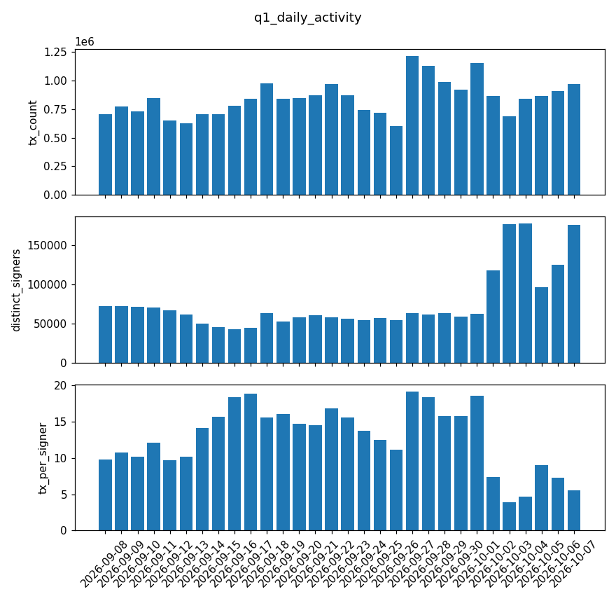
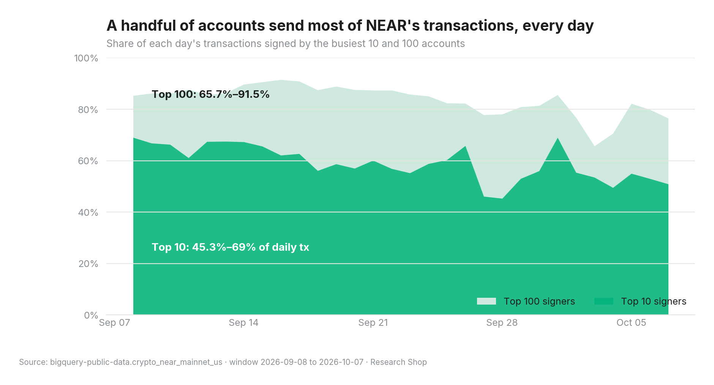
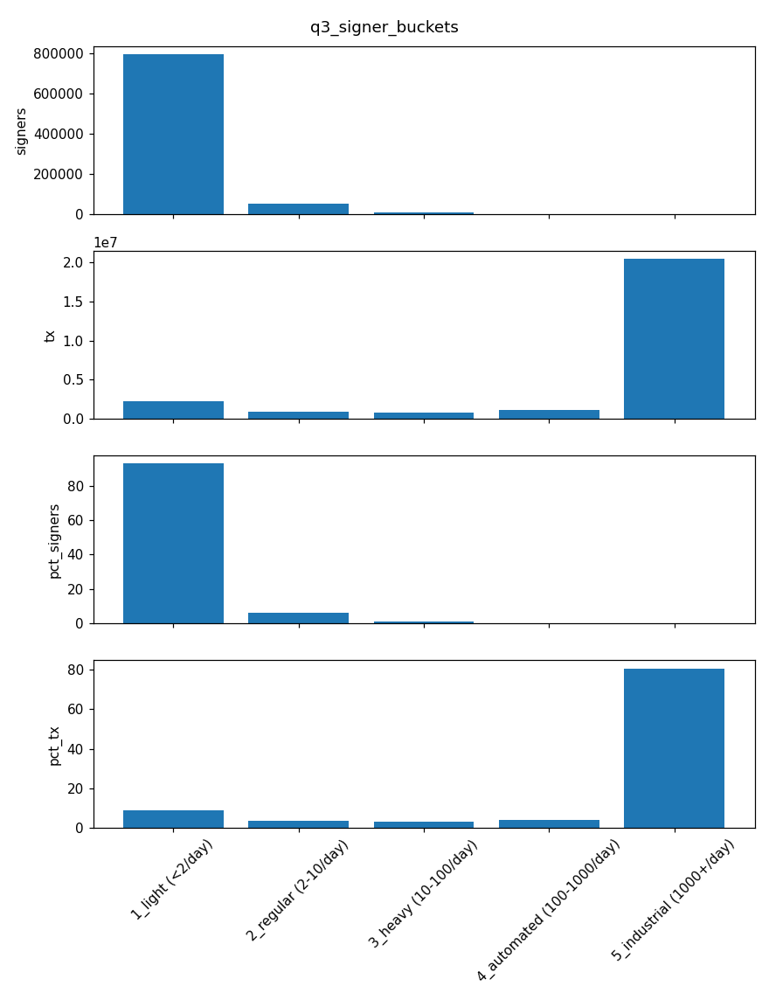
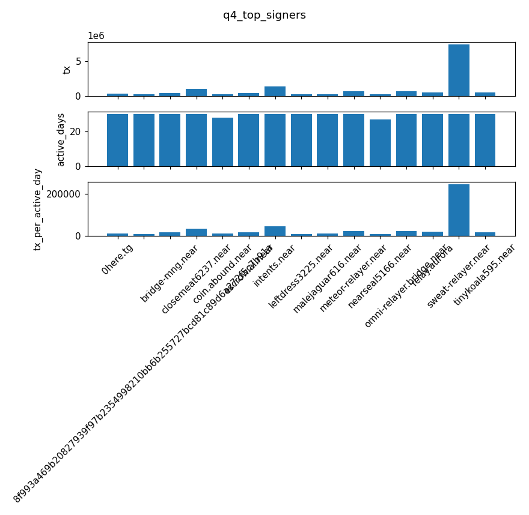

# NEAR activity: real users or bots?

*Research Shop sample report · Window 2026-09-08 to 2026-10-07 (30 days) · Every number below comes from the query results in this pack and can be re-run with `make verify`.*

## Claim

**NEAR's raw transaction count measures automation, not people.** A tiny set of signers produces the large majority of transactions. Most of them are relayers and infrastructure accounts that sign on behalf of many end users, so this is evidence of concentration, not proof of fake activity. **Distinct signers is the better measure of users, and it moved sharply in early October.**

## Evidence for

1. **Over the 30 days, 90 signers (0.01% of all signers) produced 80.7% of all transactions**: 20,446,122 transactions, each from a signer averaging 1,000+ transactions per active day. *(q3)*
2. **Light users are the majority of signers but a small share of volume.** 795,727 signers (93.03%) averaged fewer than 2 transactions per active day and produced 8.9% of transactions. *(q3)*
3. **Concentration is persistent day after day.** The 10 busiest signers produced between 45.3% and 69% of each day's transactions. The 100 busiest produced between 65.7% and 91.5%. *(q2)*
4. **The single busiest signer, `sweat-relayer.near`, sent 7,429,693 transactions,** an average of 247,656 per day, active all 30 days. Other heavy hitters include `intents.near` (1,390,976), `omni-relayer.bridge.near`, `meteor-relayer.near` and `relay.aurora`. *(q4)*
5. **Several top-15 signers have generated-looking names** (adjective-noun-digits, e.g. `closemeat6237.near` with 1,036,408 transactions, plus `leftdress3225.near`, `malejaguar616.near` and `tinykoala595.near`). Each was active all 30 days at 10,136 or more transactions per day. *(q4)* That pattern fits automated operation, but this report doesn't establish what these accounts are.

## Evidence against

1. **Relayers carry real users.** NEAR supports meta-transactions: a relayer signs and pays gas for a user's action. `sweat-relayer.near`, `meteor-relayer.near`, `relay.aurora` and `omni-relayer.bridge.near` are relayer-style accounts, so a large part of the "automated" 80.7% may be real people whose activity is counted under one signer. **Signer-level analysis undercounts users behind relayers.** It doesn't prove the activity is fake.
2. **Volume growth on the busiest day was broad-based, not bot-driven.** The window's peak, 1,217,209 transactions on 2026-09-27, came with the top-10 share *falling* to 46.1% (top 100: 77.8%). *(q1, q2)*
3. **Distinct signers surged in early October.** They went from 62,105 on 2026-10-01 to 176,719 on 2026-10-03, and stayed high (177,196 on 2026-10-04, 175,774 on 2026-10-07), while transactions per signer fell from 18.5 to 3.9. *(q1)* That's a lot of new, lightly active signers. It could be real user growth, or a campaign, airdrop or sybil wave. This data can't tell them apart.

    **Update (2026-11-02).** The follow-up [NEAR thesis](https://nearbi.ai/reports/near-thesis/) attributes this surge to one app: the new signers were sub-accounts of KaiChing (`*.users.kaiching`) signing directly, and they stopped soon after. That points to one app's campaign rather than broad organic growth. The figures in this report are unchanged.

## What would change the conclusion

- **Attributing relayer traffic to end users.** If decoding the relayed actions (receipt predecessor/receiver) shows hundreds of thousands of distinct end users behind relayers, then NEAR's real user base is much larger than its signer count, and the claim softens from "automation" to "routed through infrastructure".
- **Retention of the October signers.** If a large share of the signers who appeared 2026-10-02 to 2026-10-07 stay active for 30 days, that's real growth. If most vanish, it was a campaign or sybil wave. *Update (2026-11-02): the follow-up [NEAR thesis](https://nearbi.ai/reports/near-thesis/) attributes the surge to KaiChing sub-accounts, which stopped signing soon after.*
- **Funding graph of the generated-name accounts.** If they share funders, they're one operator, which would support the bot reading.

These are the next queries in the full deep-dive report.

## Charts









## Queries

| id | question | file |
|---|---|---|
| q1 | Daily transactions, distinct signers, transactions per signer | `queries/q1_daily_activity.sql` |
| q2 | Share of daily transactions from the top 10 / top 100 signers | `queries/q2_concentration.sql` |
| q3 | Signers and transactions by average daily activity bucket | `queries/q3_signer_buckets.sql` |
| q4 | 15 busiest signers | `queries/q4_top_signers.sql` |

Each query is bounded to a fixed `block_date` range and passed the safeguards (no relative dates, cost estimate before running). The SHA-256 hash of every result is in `manifest.json`.

## Reproduce

```bash
# no Google account needed: re-hash the shipped results
make verify-cached
# re-run every query on BigQuery (your project pays, about 3 GB in total)
gcloud auth application-default login
make verify PROJECT=<your-gcp-project>
```
